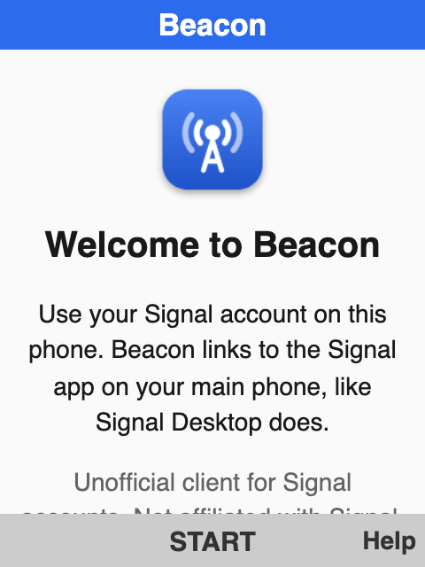
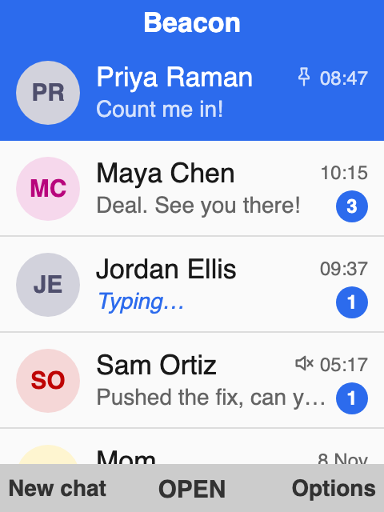
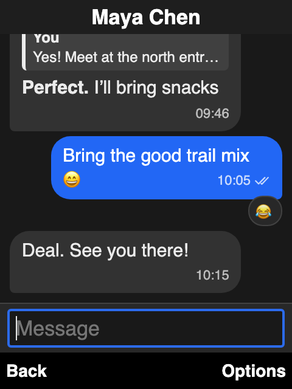
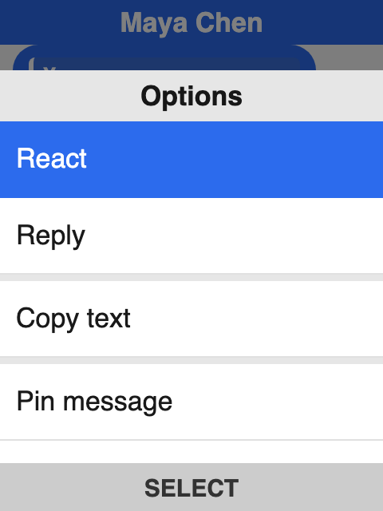
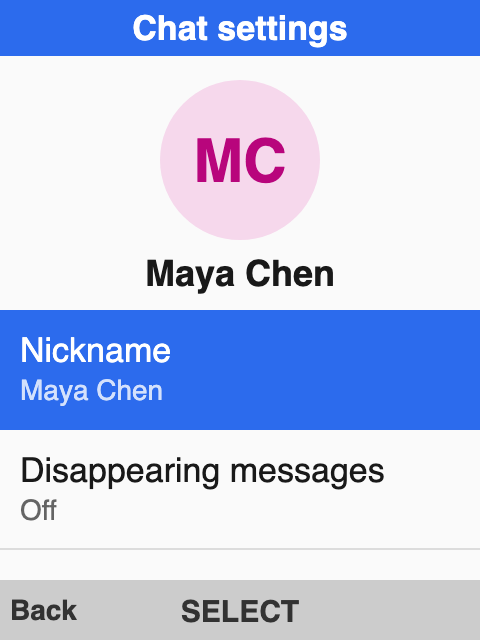
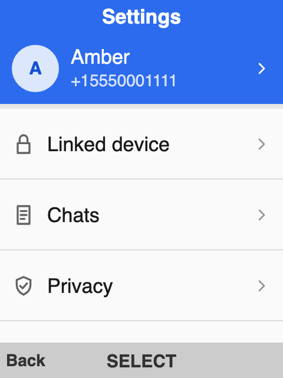

# Beacon

**An unofficial, standalone [Signal](https://signal.org) client for KaiOS 3.0, 3.1, and 4.0 feature phones.**

[**Download**](https://github.com/ambercaravalho/signal4kaios/releases/latest) · [Quickstart](#quickstart) · [Features](#features) · [Documentation](#documentation)

  

<table>
  <tr>
    <td align="center"> <b>Link in a minute</b></td>
    <td align="center"> <b>All your chats</b></td>
    <td align="center"> <b>Replies, reactions, formatting</b></td>
  </tr>
  <tr>
    <td align="center"> <b>Everything one key away</b></td>
    <td align="center"> <b>Per-chat settings</b></td>
    <td align="center"> <b>Light and dark themes</b></td>
  </tr>
</table>

> [!NOTE]
> Beacon is a work in progress. Everyday messaging, groups, and sync work, but calls, stories, and some other Signal features don't yet. The [roadmap](https://github.com/ambercaravalho/signal4kaios/issues?q=is%3Aissue%20state%3Aopen%20label%3Aroadmap) tracks everything that's missing.

## Why Beacon

- **It's really Signal.** Your messages use the same end-to-end encryption as the official apps, and they reach the people you talk to on Android, iPhone, and Desktop as normal Signal messages.
- **Private by design.** Keys are created and kept on the phone. There's no gateway, no bridge, and no computer to leave running.
- **Built for keypads.** Lists, menus, and softkeys follow KaiOS conventions, so every action is a few key presses away and nothing needs a touchscreen.
- **Plain language.** Screens say what they do in everyday words; the technical details live in **Settings → Debug** for when you need them.

## Quickstart

You need a KaiOS 3.0, 3.1, or 4.0 phone and a Signal account on your main phone.

1. **Install.** Download `signal4kaios-<version>.zip` from [Releases](https://github.com/ambercaravalho/signal4kaios/releases) and install it from OStore's **Manual Install** tab, or sideload it with [`appscmd`](https://github.com/kaiostech/appscmd).
2. **Link.** Open Beacon and press **Start**; it shows a QR code. On your main phone, go to Signal → **Settings → Linked devices → Link a new device** and scan it.
3. **Chat.** Contacts and groups sync from your account within a minute.

> [!IMPORTANT]
> KaiOS 4.0 blocks WebAssembly by default. Do the one-time [rooted WebAssembly step](docs/setup.md#kaios-40-enable-webassembly) before the first launch.

The [setup guide](docs/setup.md) covers every install route and what to do if something goes wrong.

## Features

| Area | What you get |
| --- | --- |
| **Encryption** | libsignal on the phone: PQXDH, Double Ratchet, Sealed Sender, Sender Keys, safety numbers, and AES-256 attachment encryption |
| **Messaging** | 1:1 and group chats, reactions, replies, edits, delete for everyone, read receipts, typing indicators, text formatting, polls, and link previews |
| **Privacy** | A screen lock PIN, who can see and find your number, read receipt and typing controls, and blocking |
| **Disappearing messages** | Per-chat timer, a live countdown on each message, and automatic deletion |
| **Media** | Encrypted photos, video, voice notes, and files via Signal's CDNs |
| **Sync** | Contacts, groups, blocked list, and profiles from Signal's Storage Service and your primary device; nicknames, blocking, archive, mute, pinned chats, and your username sync back |
| **Groups** | Rename, description, timer, members, admins, invites, permissions, group links, joining by link, leave, and block, as real Groups V2 changes |
| **Organization** | Multiple accounts, archived, muted, and pinned chats, pinned messages, a Signal username with its QR code, and local search |

For what isn't supported yet, see [Known limitations](docs/user-guide.md#known-limitations) and the [roadmap](https://github.com/ambercaravalho/signal4kaios/issues?q=is%3Aissue%20state%3Aopen%20label%3Aroadmap).

## Documentation

| Guide | Covers |
| --- | --- |
| [Setup](docs/setup.md) | Installing, linking, KaiOS 4.0 WebAssembly, and troubleshooting |
| [User guide](docs/user-guide.md) | Every feature and the keypad reference |
| [Architecture](docs/architecture.md) | How the app, the engine, and libsignal fit together |
| [Development](docs/development.md) | Building, testing, bumping pins, and releasing |
| [Changelog](CHANGELOG.md) | Release notes |
| [Roadmap](https://github.com/ambercaravalho/signal4kaios/issues?q=is%3Aissue%20state%3Aopen%20label%3Aroadmap) | Signal features that aren't supported yet, by area |

## Contributing

Bug reports and pull requests are welcome. [Development](docs/development.md) explains how to build the app and the libsignal wrapper, run the tests, and package a release; please [open an issue](https://github.com/ambercaravalho/signal4kaios/issues) before starting on anything large.

## License

[GPL-3.0](LICENSE). The app bundles Signal's [libsignal](https://github.com/signalapp/libsignal) (AGPL-3.0-only) compiled to WebAssembly; GPL-3.0 section 13 permits that combination. See [NOTICE](NOTICE).

Beacon is an independent project and is not affiliated with or endorsed by Signal Messenger, LLC or KaiOS Technologies.
