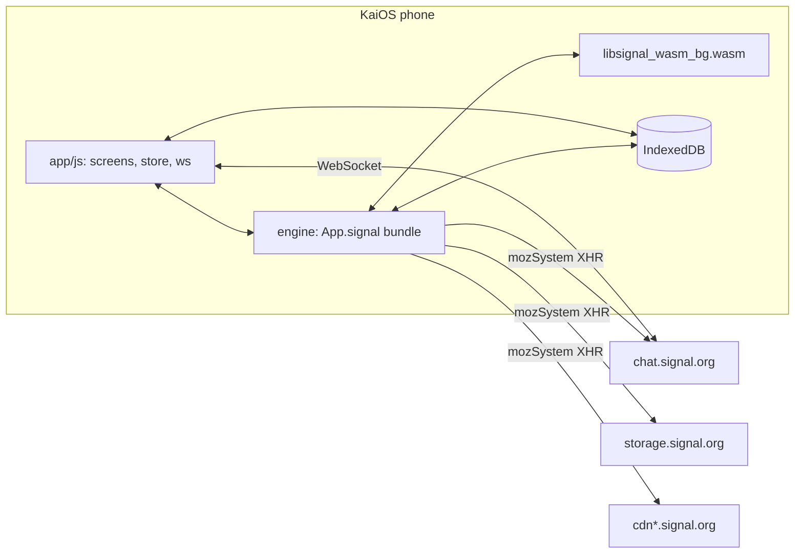
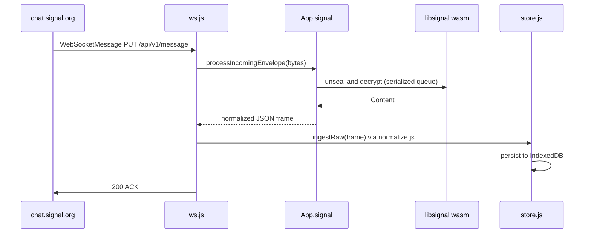
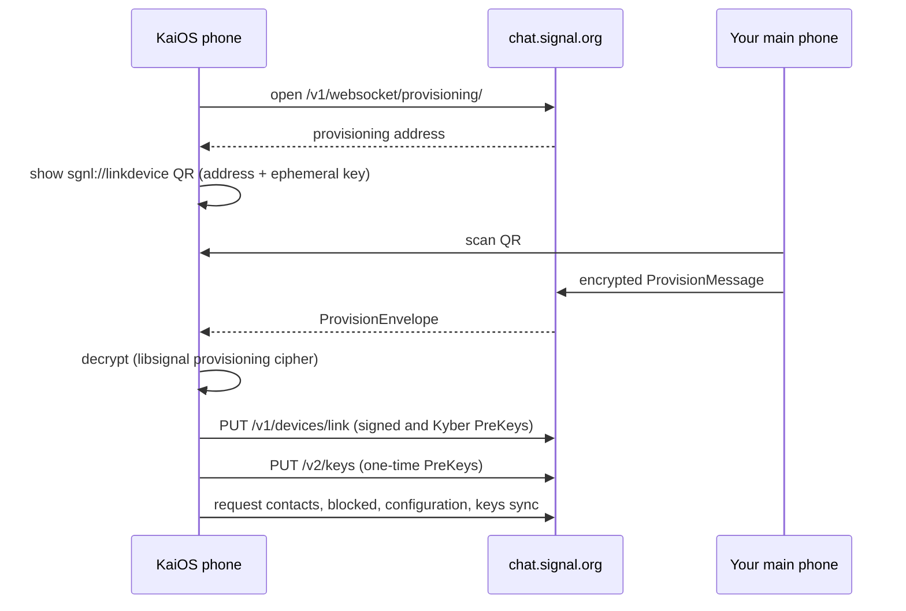
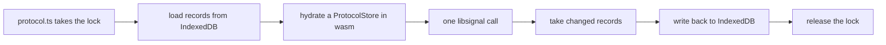

# Architecture

How signal4kaios turns a KaiOS phone into a Signal linked device. For building and testing, see [Development](development.md).

- [Overview](#overview)
- [Repository layout](#repository-layout)
- [Receiving](#receiving)
- [Sending](#sending)
- [Linking](#linking)
- [The libsignal wrapper](#the-libsignal-wrapper)
- [Engine modules](#engine-modules)
- [Storage](#storage)
- [Security model](#security-model)

## Overview

The app has three layers, and the phone talks only to Signal's servers.



| Layer | Where | Role |
| --- | --- | --- |
| **UI** | [`app/js/`](../app/js) | Plain ES5-style IIFE modules on `window.App`, loaded in [`index.html`](../app/index.html) order |
| **Engine** | [`engine/`](../engine) | TypeScript bundled by esbuild into `app/vendor/signal-engine.bundle.js`, exposed as `App.signal` |
| **libsignal** | [`native/libsignal-wasm/`](../native/libsignal-wasm) | A wasm-bindgen wrapper over Signal's official [libsignal](https://github.com/signalapp/libsignal) crates, shipped as `app/vendor/libsignal_wasm_bg.wasm` |

Wire formats come from Signal-Desktop's and libsignal's own `.proto` files in [`protos/`](../protos), compiled to TypeScript with [protobuf-es](https://github.com/bufbuild/protobuf-es).

## Repository layout

```text
app/                    the packaged KaiOS app (zipped as-is)
  js/core/              bootstrap, platform (B2G APIs), util, config, theme, toast, http, db
  js/data/              api (App.api), normalize, ws (Signal WebSocket), store, wake (closed-app alarms)
  js/ui/                nav, softkeys, router, dialogs, menus, avatars
  js/screens/           one module per screen
  sw.js                 ServiceWorker: wake alarms and notification clicks
engine/                 on-device Signal engine (App.signal)
  protocol/             libsignal loader, protocol operations, PreKeys, protocol store
  net/                  HTTP shapes, protobuf helpers, provisioning, receive, send client
  services/             Storage Service, profiles, Groups V2
  crypto/               attachment and profile cipher primitives
  gen/                  generated protobuf codecs (never hand-edited)
native/libsignal-wasm/  Rust wrapper crate (AGPL-3.0-only)
protos/                 vendored Signal .proto files
scripts/                package.sh, install.sh
test/                   unit, interop, and known-answer tests
```

## Receiving



A frame is acknowledged only after it has been decrypted and stored, so a crash never loses a message. Envelopes are decrypted one at a time ([`net/client.ts`](../engine/net/client.ts) `enqueueDecryptEnvelope`). A message that fails to decrypt triggers a `DecryptionErrorMessage` retry receipt to the sender. After the initial offline queue drains (`/api/v1/queue/empty`), queued messages don't each raise a notification.

## Sending

`App.store.send*` writes an optimistic `pending` message, then calls [`App.api`](../app/js/data/api.js) → `App.signal.send`. The engine:

1. Resolves the recipient to an ACI (phone numbers via synced contacts).
2. Builds the `Content` protobuf and pads it.
3. For each of the recipient's devices, establishes a session from a PreKey bundle if needed (PQXDH) and encrypts with the Double Ratchet. When the recipient's profile key is known, it wraps the result in Sealed Sender with an `Unidentified-Access-Key`.
4. Sends `PUT /v1/messages/<aci>`, and on `409`/`410` updates the device list and retries.
5. Sends a sync copy to your other devices.

Group messages go to each member individually.

## Linking



This follows Signal-Desktop's linking flow ([`AccountManager`](https://github.com/signalapp/Signal-Desktop/tree/main/ts/textsecure)). Afterwards the engine pulls contacts and groups from the [Storage Service](https://github.com/signalapp/Signal-Desktop/blob/main/protos/SignalStorage.proto) and group state from `storage.signal.org/v2/groups/`.

## The libsignal wrapper

The wrapper is record-in, record-out: libsignal never touches IndexedDB directly.



Every libsignal call that touches protocol state goes through [`engine/protocol/protocol.ts`](../engine/protocol/protocol.ts), which serializes these cycles. Failures come back as JS errors whose `name` is a stable code such as `UntrustedIdentity` or `DuplicatedMessage`.

| Rust module | Provides |
| --- | --- |
| `store.rs` | In-memory libsignal stores, filled with `put*` and drained with `take*` |
| `keys.rs` | Identity keys, XEdDSA, registration IDs, and PreKey, signed PreKey, and Kyber PreKey records |
| `session.rs` | PreKey bundles, encrypt and decrypt (PQXDH, SPQR), `DecryptionErrorMessage`, `PlaintextContent` |
| `sealed.rs` | Sealed Sender with SenderCertificate validation against Signal's trust roots |
| `group.rs` | Sender Key distribution and group encrypt and decrypt |
| `fingerprint.rs` | Safety numbers and scannable fingerprints |
| `provisioning.rs` | The linking cipher |
| `account.rs` | Account Entropy Pool to master key, and username hashes |
| `zk.rs` | Profile key version, commitment, and access key; Groups V2 params, blob and member decryption, and auth credential presentations |

## Engine modules

| File | Responsibility |
| --- | --- |
| [`index.ts`](../engine/index.ts) | The `App.signal` bridge: recipients, sync messages, sends, groups, Storage Service refresh |
| [`protocol/libsignal.ts`](../engine/protocol/libsignal.ts) | Loads the wasm module (`ready()`) |
| [`protocol/protocol.ts`](../engine/protocol/protocol.ts) | Hydrate, call, and flush around each libsignal operation; trust policy; Sealed Sender trust roots |
| [`protocol/prekeys.ts`](../engine/protocol/prekeys.ts) | Signed, last-resort Kyber, and one-time PreKeys |
| [`protocol/store.ts`](../engine/protocol/store.ts) | `SignalProtocolStore` over IndexedDB (and in memory for tests) |
| [`net/http.ts`](../engine/net/http.ts) | Signal hosts and the HTTP function shapes passed in from `app/js/core/http.js` |
| [`net/proto.ts`](../engine/net/proto.ts) | WebSocket framing, service IDs, and delimited streams over the generated codecs |
| [`net/provisioning.ts`](../engine/net/provisioning.ts) | Linking, device name cipher, and the initial PreKey upload |
| [`net/receive.ts`](../engine/net/receive.ts) | Envelope decryption and `Content` → JSON frames; contact sync blobs |
| [`net/client.ts`](../engine/net/client.ts) | `SignalClient`: device fanout, Sealed Sender, retry receipts, attachment upload and download |
| [`services/storage-service.ts`](../engine/services/storage-service.ts) | Read-only Storage Service sync, with Signal-Desktop's key derivation |
| [`services/profiles.ts`](../engine/services/profiles.ts) | Versioned profile fetch and decrypt, profile upload, avatars, username lookup |
| [`services/groups-v2.ts`](../engine/services/groups-v2.ts) | zkgroup group IDs, `GroupContextV2`, and group state fetch |
| [`crypto/`](../engine/crypto) | WebCrypto AES and [`@noble/hashes`](https://github.com/paulmillr/noble-hashes) HMAC/HKDF for attachments, profiles, and storage |

## Storage

Each account has its own IndexedDB database (`App.db`, schema version 4):

| Store | Holds |
| --- | --- |
| `messages`, `conversations`, `contacts` | Chat history and the conversation list |
| `kv` | Synced contacts and groups, credentials caches, and settings |
| `attachments` | Cached decrypted media (LRU) |
| `signal_keystore`, `signal_identities`, `signal_sessions`, `signal_prekeys`, `signal_sender_keys` | Serialized libsignal records and remote identity keys |

Upgrading from a database older than version 4 discards the protocol state and asks you to link again.

## Security model

- **Keys stay on the phone.** Identity keys, sessions, and the account password live only in IndexedDB. The ServiceWorker's wake probe caches the login in origin-isolated Cache Storage so it can check Signal's queue.
- **Untrusted input.** WebSocket frames, protobufs, and HTTP responses are all parsed defensively; a bad frame is logged and dropped.
- **Sync messages** are accepted only from our own ACI. Recipients must be ACIs.
- **Identity changes.** A contact's first identity key is trusted on first use. If it later changes, the contact drops to untrusted, and if you had verified them, sending stops until you review the new safety number.
- **Sealed Sender** certificates are checked against Signal's production trust roots.
- **CSP.** The privileged-app CSP forbids `eval`, `new Function`, and inline scripts, and `scripts/package.sh` fails the build if any shipped script contains them.
- **Logs.** The debug log never records keys, passwords, or provisioning codes.
