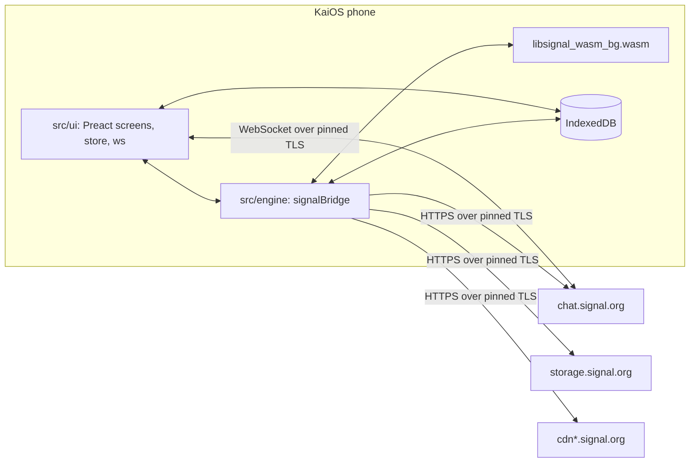
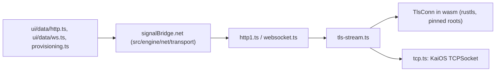
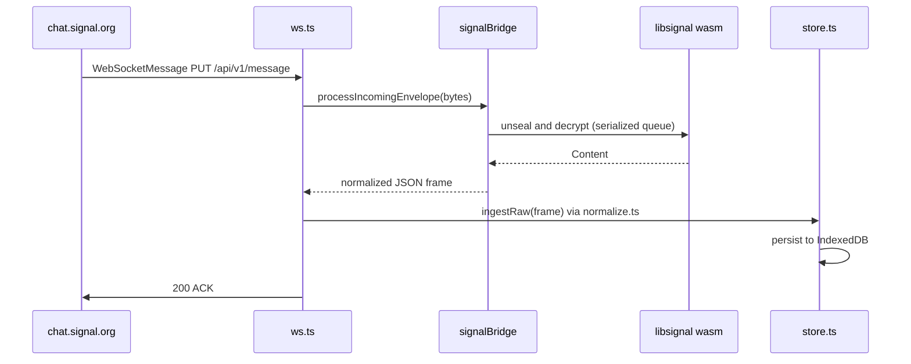
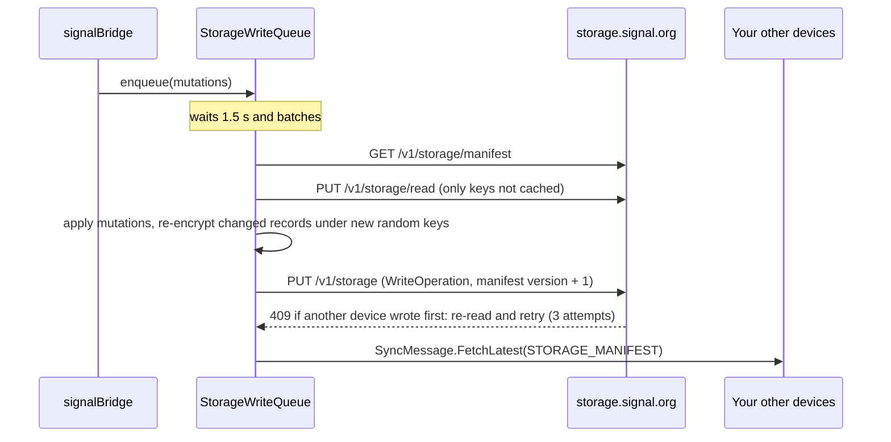
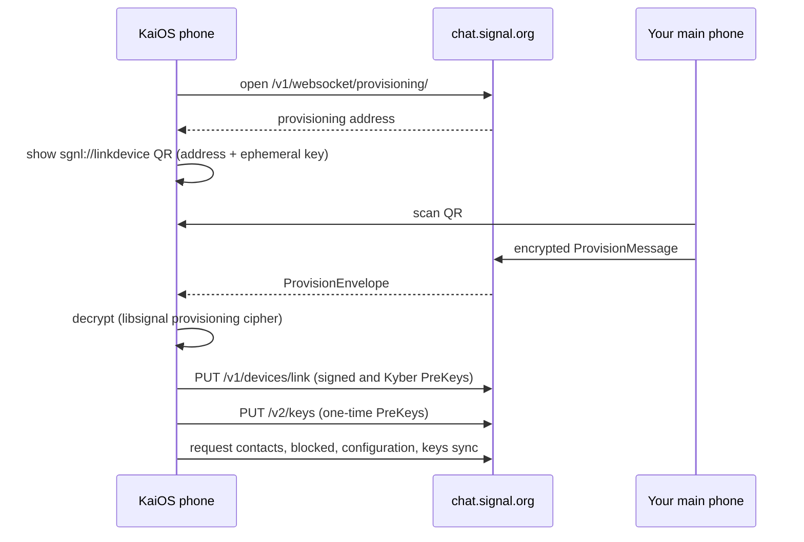
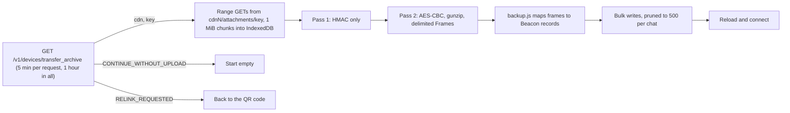
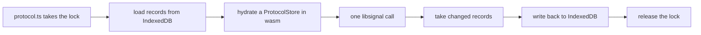

# Architecture

How Beacon (the signal4kaios repository) turns a KaiOS phone into a Signal linked device. For building and testing, see [Development](development.md).

- [Overview](#overview)
- [Network](#network)
- [Repository layout](#repository-layout)
- [The app](#the-app)
- [Receiving](#receiving)
- [Sending](#sending)
- [Storage Service writes](#storage-service-writes)
- [Group changes](#group-changes)
- [Linking](#linking)
- [The libsignal wrapper](#the-libsignal-wrapper)
- [Engine modules](#engine-modules)
- [Storage](#storage)
- [Security model](#security-model)

## Overview

The app has three layers, and the phone talks only to Signal's servers.



| Layer | Where | Role |
| --- | --- | --- |
| **App** | [`src/ui/`](../src/ui) | [Preact](https://preactjs.com) and TypeScript: screens, components, and the data layer (store, WebSocket, IndexedDB). See [The app](#the-app) |
| **Engine** | [`src/engine/`](../src/engine) | TypeScript Signal engine, imported by the app as `signalBridge` and bundled with it into `src/app/build/app.js` |
| **libsignal** | [`src/native/libsignal-wasm/`](../src/native/libsignal-wasm) | A wasm-bindgen wrapper over Signal's official [libsignal](https://github.com/signalapp/libsignal) crates, shipped as `src/app/vendor/libsignal_wasm_bg.wasm` |

Wire formats come from Signal-Desktop's and libsignal's own `.proto` files in [`src/protos/`](../src/protos), compiled to TypeScript with [protobuf-es](https://github.com/bufbuild/protobuf-es).

## Network

Every Signal service (`chat`, `storage`, `cdn`, `cdn2`, `cdn3`) presents a certificate from Signal's own root, `CN=Signal Messenger`, which no browser trusts. Gecko's `WebSocket` and XHR therefore fail on a stock phone with close code 1015. The app does TLS itself instead, the way Signal's own apps do:



| Piece | Role |
| --- | --- |
| [`src/native/libsignal-wasm/src/tls.rs`](../src/native/libsignal-wasm/src/tls.rs) | A sans-I/O [rustls](https://github.com/rustls/rustls) client that trusts only libsignal's pinned roots (`signal.cer`, `signal-ed25519.cer` in `res/`) and refuses any host outside `signal.org` |
| [`transport/tcp.ts`](../src/engine/net/transport/tcp.ts) | The raw socket, from the `tcp-socket` manifest permission (`TCPSocket`, or `navigator.mozTCPSocket` on older builds) |
| [`transport/tls-stream.ts`](../src/engine/net/transport/tls-stream.ts) | Pumps bytes between the socket and `TlsConn`, and resolves once the handshake is done |
| [`transport/http1.ts`](../src/engine/net/transport/http1.ts) | HTTP/1.1 with keep-alive, at most 6 requests per host at once, capped response sizes, and timeouts |
| [`transport/websocket.ts`](../src/engine/net/transport/websocket.ts) | An RFC 6455 client shaped like the browser `WebSocket`, so callers use either one |

Only `*.signal.org` goes through this path, and all of it does, attachment CDNs included, whatever certificates the phone trusts. Other hosts, and environments without `TCPSocket` (desktop browsers, the tests' fallbacks), use mozSystem XHR and the platform `WebSocket`. A redirect off Signal's hosts drops the `Authorization` header and continues over XHR.

### Signal proxy

With a [Signal proxy](https://signal.org/blog/help-iran-reconnect/) set (**Settings → Privacy → Proxy**, stored app-wide in `s4k.config`), each pinned connection has two TLS layers. The outer one is a `TCPSocket` opened with `useSecureTransport: true` to `<proxy>:443`, so Gecko checks the proxy's ordinary public certificate against the phone's CA store. Inside that stream `tls-stream.ts` runs the usual pinned `TlsConn` handshake with the Signal host's name as SNI, and the proxy (for example [Signal-TLS-Proxy](https://github.com/signalapp/Signal-TLS-Proxy)) forwards by reading that name. The proxy learns that a Signal host was reached, never the traffic or the credentials inside it. `createNet` holds the proxy host; [`src/ui/data/proxy.ts`](../src/ui/data/proxy.ts) parses `https://signal.tube/#<host>` and `sgnl://signal.tube/?host=<host>` links as untrusted input, and changing the setting drops kept-alive connections and reconnects the chat socket.

While a proxy is set nothing for Signal's hosts goes out directly: the platform `WebSocket` fallback is refused, and a request to a `signal.org` host that can't use the pinned client fails instead of falling back to XHR. Link previews, and CDN redirects to hosts outside `signal.org`, still connect directly.

The chat WebSocket authenticates with an `Authorization: Basic` header on the upgrade request. Signal's server treats query-string credentials as an anonymous socket that never receives messages, which is why only the pinned client can carry the main connection.

A ServiceWorker can't use any of this, because workers have no `TCPSocket`, and the browser `WebSocket` can't set the header. So a closed app can't receive messages: [`sw.js`](../src/app/sw.js) only relays wake alarms to an open window and handles notification taps, besides the page rewrite below. See [the user guide](user-guide.md#known-limitations).

### WebAssembly on KaiOS 4.0

KaiOS 4.0 serves apps through [`api-daemon`](https://github.com/kaiostech/api-daemon), which sends every app page with a `Content-Security-Policy` header whose `script-src` lacks `'wasm-unsafe-eval'`, and Gecko 123 enforces that for `WebAssembly.compile`. The app can't change the daemon's config, but its own ServiceWorker answers its page loads: `sw.js` fetches the page and returns it with the same header plus `'wasm-unsafe-eval'` in each `script-src`, leaving every other directive and header alone. JavaScript `eval` and inline scripts stay blocked. Other requests are never answered by the worker, and a page that has no `script-src`, already allows WebAssembly, or fails to load passes through untouched. KaiOS 3.x (Gecko 84) doesn't gate WebAssembly on CSP, so the rewrite changes nothing there.

The first launch after an install or update can load before the new worker controls the page. When libsignal then fails with `blocked`, [`src/ui/data/wasm-reload.ts`](../src/ui/data/wasm-reload.ts) waits up to five seconds for the newest `sw.js` to be active and reloads once per session; only a second failure shows **Beacon couldn't start**.

## Repository layout

```text
src/
  app/                    the packaged KaiOS app (zipped as-is)
    index.html            loads build/app.js and build/app.css
    build/                esbuild output (gitignored): app.js, app.css, and backup.js
    assets/icons/         beacon.svg and the launcher PNGs rendered from it
    vendor/               libsignal_wasm_bg.wasm
    sw.js                 ServiceWorker: KaiOS 4.0 WebAssembly policy, wake alarms, notification taps
  ui/                     the app (Preact + TypeScript)
    main.tsx              startup: theme, engine host, ServiceWorker, first screen
    app/                  router, focus and key handling, hooks, theme
    components/           shared building blocks (lists, dialogs, softkeys, QR, emoji)
    components/chat/      chat bubbles, message options, and the chat screen's session, composer, and key hooks
    screens/              one module per screen or group of related screens
    screens/settings/     the Settings sub-screens
    data/                 ws, db, config, http, attachments, platform (B2G APIs), wasm-reload
    data/store/           conversations, messages, sends, and the event hub, behind the data/store.ts barrel
    data/normalize/       JSON frames to store events, behind the data/normalize.ts barrel
    theme/                CSS tokens and styles
    strings.ts            every user-facing string, plus the Debug screen's wording
  engine/                 on-device Signal engine (signalBridge, assembled in index.ts)
    bridge/               signalBridge methods by area: account, incoming, outgoing, contacts, groups, sync
    protocol/             libsignal loader, protocol operations, PreKeys, protocol store
    net/                  HTTP shapes, protobuf helpers, provisioning, receive, send client
    net/transport/        pinned TLS over TCPSocket: HTTP/1.1 and WebSocket clients
    services/             Storage Service (storage/), message history from linking (history/), profiles, Groups V2
    crypto/               attachment and profile cipher primitives
    gen/                  generated protobuf codecs (never hand-edited)
  native/libsignal-wasm/  Rust wrapper crate (AGPL-3.0-only)
  protos/                 vendored Signal .proto files
scripts/                  build.mjs, icons.mjs, package.sh, install.sh
test/                     unit, interop, and known-answer tests
docs/                     these guides
```

## The app

The app is a single Preact tree built for Gecko 84, the oldest engine it supports (KaiOS 3.0). [`scripts/build.mjs`](../scripts/build.mjs) bundles `src/ui/main.tsx`, the engine, and the CSS into `src/app/build/`, so `index.html` loads one script and one stylesheet, with no inline code for the privileged CSP to reject. A second bundle, `backup.js`, holds the large Backups codec and the archive frame mapper; it loads with a `<script src>` tag only while message history is imported after linking (see [Message history](#message-history)), so it costs nothing at startup.

| Piece | Role |
| --- | --- |
| [`app/router.tsx`](../src/ui/app/router.tsx) | A screen stack. `router.push` opens a screen, `router.overlay` opens a menu or dialog above it and resolves a promise with the choice, `pop`/`replace`/`reset` move back. Screens below the top stay mounted, so going back keeps their state and scroll position |
| `useKeys`, `useSoftkeys` | Keys go to the top entry, innermost handler first. Each entry declares its softkey labels, and the left one defaults to **Back** on pushed screens |
| [`components/RowList.tsx`](../src/ui/components/RowList.tsx) | The KaiOS list most screens are built from: rows with optional section headers, toggles, and per-row center labels |
| [`data/store.ts`](../src/ui/data/store.ts) | Conversations and messages in IndexedDB, plus an event hub, implemented in [`data/store/`](../src/ui/data/store). Screens subscribe with `useStoreEvents` and re-render on the events they care about |
| [`strings.ts`](../src/ui/strings.ts) | Every user-facing string. `S` must stay free of protocol jargon (a test enforces this); `DEBUG` holds the Settings > Debug wording |
| [`theme/`](../src/ui/theme) | KaiOS metrics (header, softkey bar, list rows) with Signal's light and dark colors, switched by `data-theme` on `<html>` |

Startup ([`main.tsx`](../src/ui/main.tsx)) loads libsignal and opens the database, then shows the chats if the phone is linked, or the welcome and linking screens if not. If libsignal or the database can't load, it shows a startup error with a restart option instead.

## Receiving



A frame is acknowledged only after it has been decrypted and stored, so a crash never loses a message. Envelopes are decrypted one at a time ([`net/client.ts`](../src/engine/net/client.ts) `enqueueDecryptEnvelope`). A message that fails to decrypt triggers a `DecryptionErrorMessage` retry receipt to the sender. After the initial offline queue drains (`/api/v1/queue/empty`), queued messages don't each raise a notification.

When the main phone changes the account's number, it sends each linked device a `SyncMessage.PniChangeNumber` with that device's new PNI identity key pair, signed PreKey, last-resort Kyber PreKey, and registration ID, and the envelope carries the new PNI (`updatedPni`). [`services/change-number.ts`](../src/engine/services/change-number.ts) applies it inside the decryption queue, as Signal-Desktop does, because the envelopes after it may be addressed to the new PNI: libsignal parses the records, the old PNI identity is dropped, group credentials and the sender certificate are cleared, and fresh PNI PreKeys are uploaded. The app then shows the new number, but the account's database keeps the name it was created under (`dbNumber` in `s4k.config`), since IndexedDB can't rename a database.

## Sending

`store.send*` in [`src/ui/data/store/send.ts`](../src/ui/data/store/send.ts) writes an optimistic `pending` message, then calls the engine's `signalBridge.send`. The engine:

1. Resolves the recipient to an ACI (phone numbers via synced contacts).
2. Builds the `Content` protobuf and pads it.
3. For each of the recipient's devices, establishes a session from a PreKey bundle if needed (PQXDH) and encrypts with the Double Ratchet. When the recipient's profile key is known, it wraps the result in Sealed Sender with an `Unidentified-Access-Key`.
4. Sends `PUT /v1/messages/<aci>`, and on `409`/`410` updates the device list and retries.
5. Sends a sync copy to your other devices.

Group messages use Sender Keys, following Signal-Desktop's `sendToGroup`. [`services/group-send.ts`](../src/engine/services/group-send.ts) keeps the group send endorsements that come with each `GroupResponse` (refetched when they're missing, don't cover every member, or are about to expire) and a distribution ID per group, along with the member devices that already have our `SenderKeyDistributionMessage`. A send gives that message to devices that lack it (1:1, as above), then encrypts the content once with the sender key, wraps it in multi-recipient Sealed Sender, and sends one `PUT /v1/messages/multi_recipient` with a `Group-Send-Token` built from the endorsements. A `409`/`410` fixes the device lists and retries once, members in `uuids404` are dropped, and a member who left gets a new distribution ID so they can't read later messages. Groups without endorsements, groups with fewer than two other members, and any other failure fall back to sending to each member individually; so do group-change notifications.

Voice messages are recorded in [`src/ui/data/voice-recorder.ts`](../src/ui/data/voice-recorder.ts). Gecko's MediaRecorder only makes Ogg Opus, which not every Signal app plays, so the recording is decoded with an `OfflineAudioContext` at 16 kHz, mixed to mono, and encoded to MP3 with [`@breezystack/lamejs`](https://github.com/shijinyu/lamejs) as Signal-Desktop sends them. The waveform is Desktop's `WaveformBuilder` (up to 100 bars of 0 to 255). The send payload's `attachment_meta` carries the flag, waveform, and length to [`services/attachment-meta.ts`](../src/engine/services/attachment-meta.ts), which sets `VOICE_MESSAGE`, `audioWaveform`, and `audioDurationSeconds` on the uploaded pointer; received pointers are read back the same way, with the waveform cut to 100 bars.

Pins (`DataMessage.pinMessage` / `unpinMessage`), disappearing-timer updates in 1:1 chats, and the full blocked list (`SyncMessage.Blocked`) use the same send path. Typing indicators and read receipts are not sent to blocked people, and content from blocked people and groups is dropped on receipt but still acknowledged.

## Storage Service writes

Contact nicknames, blocking, archive, mute, pinned chats, chat folders, and the username are account state that Signal keeps in the encrypted [Storage Service](https://github.com/signalapp/Signal-Desktop/blob/main/protos/SignalStorage.proto). Edits go through `mutateStorage` in [`services/storage/mutate.ts`](../src/engine/services/storage/mutate.ts), following Signal-Desktop's `storage.ts`:



The new manifest keeps every identifier it doesn't touch, including record types this app doesn't read, and unknown protobuf fields survive the re-encode. Each pull marks the records another device wrote since the previous pull as `changed`. Archive, mute, and pinned-chat state is applied only from those records, and the store's `applyChatState` applies it without writing it back, so local and remote changes don't overwrite each other in a loop.

The username itself is claimed on the chat server first: [`services/usernames.ts`](../src/engine/services/usernames.ts) reserves one of libsignal's candidates (`PUT /v1/accounts/username_hash/reserve`) and confirms it with a zero-knowledge proof and an encrypted username link (`PUT /v1/accounts/username_hash/confirm`). Only then are the username and link written to the account record. The QR code is `https://signal.me/#eu/` followed by the link's entropy and server ID.

## Group changes

Group edits are Groups V2 changes, built and signed as in Signal-Desktop's `groups.ts`. [`services/group-changes.ts`](../src/engine/services/group-changes.ts) fetches the group, builds `GroupChange.Actions` from a snapshot of the decrypted state (title, description, timer, access control, invite link, members, roles, invites, leave), and sends `PATCH /v2/groups/` at revision + 1 with a zkgroup auth credential presentation. A `409` rebuilds the change once against the new state; a `403` becomes "you don't have permission".

The server returns the signed `GroupChange`, which the bridge sends as `DataMessage.groupV2 { masterKey, revision, groupChange }` to everyone in the group before and after the change, plus a sync copy to your other devices. Adding someone joins them directly when their profile key credential can be fetched (`GET /v1/profile/{aci}/{version}/{request}?credentialType=expiringProfileKey`), and invites them otherwise.

Group photos follow Signal-Desktop's `decryptGroupAvatar`: the decoded state keeps `Group.avatarUrl` (a `groups/…` key on CDN 0), and [`services/group-avatar.ts`](../src/engine/services/group-avatar.ts) downloads that blob and decrypts it as a `GroupAttributeBlob` with the group's secret params. The bridge caches the photo per avatar key under `avatar:group:<id>`, so a changed photo is fetched again; groups saved before 2.9.1 get one state refresh to learn their key.

## Linking



This follows Signal-Desktop's linking flow ([`AccountManager`](https://github.com/signalapp/Signal-Desktop/tree/main/ts/textsecure)). Afterwards the engine pulls contacts and groups from the [Storage Service](https://github.com/signalapp/Signal-Desktop/blob/main/protos/SignalStorage.proto) and group state from `storage.signal.org/v2/groups/`.

### Message history

Beacon ports Signal-Desktop's link-and-sync. The QR code carries `capabilities=backup5`, so the main phone offers **Transfer message history**; its `ProvisionMessage` then includes a 32-byte `ephemeralBackupKey`, which the app keeps in config only until the import ends and never logs.



- **Keys and reading.** `backup.rs` derives the `MessageBackupKey` with libsignal's `libsignal-account-keys` (`BackupKey::derive_backup_id`, then `MessageBackupKey::derive` with the legacy domain separator, as Desktop does for link-and-sync). Its streaming `BackupReader` takes the archive chunk by chunk: HMAC-SHA256 over everything but the last 32 bytes, AES-256-CBC, gzip (`flate2` on `miniz_oxide`), and varint-delimited frames. Gecko 84 has neither streaming WebCrypto nor `DecompressionStream`, so this all runs in wasm. The first pass only checks the MAC, so nothing is imported from a tampered or truncated file.
- **Mapping.** [`services/history/frames.ts`](../src/engine/services/history/frames.ts) follows Desktop's `backups/import`. Recipients become contacts (profile keys go to the profile cache) and groups (master keys go to the synced groups); chats carry archive, pin, mute, marked unread, and the timer; chat items become messages with text, styles, mentions, quotes, link previews, reactions, edits, send status, pins, polls, and deletions, or notices for timer changes, safety numbers, calls, payments, and group changes. Expired disappearing messages, stories, call links, and records Storage Service supplies (notification profiles, chat folders, sticker packs) are skipped. Every frame is untrusted: lengths are capped, unknown cases dropped, and a frame that fails to decode costs only that frame.
- **Attachments.** A pointer with a transit CDN copy becomes an attachment descriptor that downloads like a received one, checked against `encryptedDigest`, or for archive pointers against the plaintext SHA-256 in `plaintextHash`. One without a transit copy gets an empty ID, so opening it asks the phone to upload it again.
- **The app's side.** [`data/store/history.ts`](../src/ui/data/store/history.ts) runs the steps and records each one in config, so a reload resumes the download from the next chunk and restarts the import, whose writes are idempotent. Messages go through the same normalizer as received ones but straight to IndexedDB, with no notifications or receipts. The History screen shows at startup while a sync is pending and the message WebSocket stays closed, so new messages wait on the server, as on Desktop, and nothing arrives mid-import.

## The libsignal wrapper

The wrapper is record-in, record-out: libsignal never touches IndexedDB directly.



Every libsignal call that touches protocol state goes through [`src/engine/protocol/protocol.ts`](../src/engine/protocol/protocol.ts), which serializes these cycles. Failures come back as JS errors whose `name` is a stable code such as `UntrustedIdentity` or `DuplicatedMessage`.

| Rust module | Provides |
| --- | --- |
| `store.rs` | In-memory libsignal stores, filled with `put*` and drained with `take*` |
| `keys.rs` | Identity keys, XEdDSA, registration IDs, and PreKey, signed PreKey, and Kyber PreKey records |
| `session.rs` | PreKey bundles, encrypt and decrypt (PQXDH, SPQR), `DecryptionErrorMessage`, `PlaintextContent` |
| `sealed.rs` | Sealed Sender with SenderCertificate validation against Signal's trust roots, and multi-recipient Sealed Sender for group sends |
| `group.rs` | Sender Key distribution and group encrypt and decrypt |
| `fingerprint.rs` | Safety numbers and scannable fingerprints |
| `provisioning.rs` | The linking cipher |
| `account.rs` | Account Entropy Pool to master key, and username hashes |
| `backup.rs` | Message backup keys and the streaming link-and-sync archive reader (see [Message history](#message-history)) |
| `username.rs` | Username candidates, zero-knowledge proofs, and encrypted username links |
| `zk.rs` | Profile key version, commitment, and access key; Groups V2 params, blob and member decryption, profile key encryption, auth and expiring profile key credential presentations; group send endorsements and tokens |
| `tls.rs` | TLS client for Signal's hosts with libsignal's pinned roots (see [Network](#network)) |

## Engine modules

| File | Responsibility |
| --- | --- |
| [`index.ts`](../src/engine/index.ts) | `signalBridge`, assembled from [`bridge/`](../src/engine/bridge): recipients, sync messages, sends, blocking, group changes, pins, usernames, chat-list state, Storage Service refresh |
| [`protocol/libsignal.ts`](../src/engine/protocol/libsignal.ts) | Loads the wasm module (`ready()`) |
| [`protocol/protocol.ts`](../src/engine/protocol/protocol.ts) | Hydrate, call, and flush around each libsignal operation; trust policy; Sealed Sender trust roots |
| [`protocol/prekeys.ts`](../src/engine/protocol/prekeys.ts) | Signed, last-resort Kyber, and one-time PreKeys |
| [`protocol/store.ts`](../src/engine/protocol/store.ts) | `SignalProtocolStore` over IndexedDB (and in memory for tests) |
| [`net/http.ts`](../src/engine/net/http.ts) | Signal hosts, the HTTP function shapes passed in from [`src/ui/data/http.ts`](../src/ui/data/http.ts), and `asObject` for untrusted JSON |
| [`net/proto.ts`](../src/engine/net/proto.ts) | WebSocket framing, service IDs, and delimited streams over the generated codecs |
| [`net/provisioning.ts`](../src/engine/net/provisioning.ts) | Linking, device name cipher, and the initial PreKey upload |
| [`net/receive.ts`](../src/engine/net/receive.ts) | Envelope decryption and `Content` → JSON frames; contact sync blobs |
| [`net/incoming-json.ts`](../src/engine/net/incoming-json.ts) | Decoded `Content` → the JSON frames the app normalizes; attachment descriptors |
| [`net/client.ts`](../src/engine/net/client.ts) | `SignalClient`: device fanout, Sealed Sender, retry receipts, attachment upload and download |
| [`net/transport/`](../src/engine/net/transport) | `signalBridge.net`: pinned TLS, HTTP/1.1, and WebSocket for Signal's hosts |
| [`services/storage/`](../src/engine/services/storage) | Storage Service key derivation (`crypto.ts`), pull (`pull.ts`), and writes (`mutate.ts`: `mutateStorage`, `StorageWriteQueue`), following Signal-Desktop; chat folders (`chat-folders.ts`, read and written) and installed sticker packs (`sticker-packs.ts`, read only) |
| [`services/history/`](../src/engine/services/history) | Link-and-sync: the transfer archive poll, ranged download, two-pass import, and the frame mapper bundled into `backup.js` |
| [`services/profiles.ts`](../src/engine/services/profiles.ts) | Versioned profile fetch and decrypt, profile upload, username lookup, expiring profile key credentials; the cipher and avatars are in `profile-crypto.ts` and `profile-avatar.ts` |
| [`services/groups-v2.ts`](../src/engine/services/groups-v2.ts) | zkgroup group IDs, `GroupContextV2`, group state fetch and decode, invite links |
| [`services/group-changes.ts`](../src/engine/services/group-changes.ts) | Groups V2 change builders and `applyGroupChange` |
| [`services/group-avatar.ts`](../src/engine/services/group-avatar.ts) | Group photo download and decrypt |
| [`services/group-send.ts`](../src/engine/services/group-send.ts) | Group send endorsements and tokens, per-group sender key distribution IDs, and which member devices have our sender key |
| [`services/usernames.ts`](../src/engine/services/usernames.ts) | Username reserve, confirm, delete, and link URLs |
| [`crypto/`](../src/engine/crypto) | WebCrypto AES and [`@noble/hashes`](https://github.com/paulmillr/noble-hashes) HMAC/HKDF for attachments, profiles, and storage |

## Storage

Each account has its own IndexedDB database ([`src/ui/data/db.ts`](../src/ui/data/db.ts), schema version 4), named `signal4kaios:<number>`:

| Store | Holds |
| --- | --- |
| `messages`, `conversations`, `contacts` | Chat history and the conversation list |
| `kv` | Synced contacts and groups, credentials caches, settings, and the downloaded history archive's chunks until the import ends |
| `attachments` | Cached decrypted media (LRU) |
| `signal_keystore`, `signal_identities`, `signal_sessions`, `signal_prekeys`, `signal_sender_keys` | Serialized libsignal records and remote identity keys |

Upgrading from a database older than version 4 discards the protocol state and asks you to link again. The database is named after the account's number, which isn't known until the `ProvisionMessage` arrives, so linking switches to the new account's database (`db.useAccount`) before it saves any keys.

## Security model

- **Keys stay on the phone.** Identity keys and sessions live only in IndexedDB, and the device password only in the app's `localStorage`. 2.0.x also cached the login for the ServiceWorker; 2.1.0 deletes that copy on upgrade.
- **Untrusted input.** WebSocket frames, protobufs, and HTTP responses are all parsed defensively; a bad frame is logged and dropped.
- **Sync messages** are accepted only from our own ACI. Recipients must be ACIs.
- **Identity changes.** A contact's first identity key is trusted on first use. If it later changes, the contact drops to untrusted, and if you had verified them, sending stops until you review the new safety number.
- **Sealed Sender** certificates are checked against Signal's production trust roots.
- **TLS.** Connections to Signal's hosts trust only the two roots libsignal pins, not the phone's certificate store, so a CA added to the phone can't intercept them.
- **CSP.** The privileged-app CSP forbids `eval`, `new Function`, and inline scripts, and `scripts/package.sh` fails the build if any shipped script contains them. On KaiOS 4.0 the ServiceWorker adds only `'wasm-unsafe-eval'` to `api-daemon`'s policy ([WebAssembly on KaiOS 4.0](#webassembly-on-kaios-40)).
- **Screen lock** ([`src/ui/data/screen-lock.ts`](../src/ui/data/screen-lock.ts)) keeps only a salted PBKDF2-SHA-256 hash of the PIN in `s4k.config`, and the wrong-PIN count, so a restart doesn't reset the wait. It covers the UI and nothing else: the databases aren't encrypted with the PIN. The PIN is read from the keypad's digit keys with no text field focused, so the keyboard never sees it.
- **Profile key.** Only the primary phone rotates the profile key; Signal-Desktop as a linked device doesn't either. A Storage Service pull whose `AccountRecord.profileKey` differs from ours replaces the account's key and drops our cached credential for the old one.
- **Logs.** The debug log never records keys, passwords, or provisioning codes. Everyday screens show plain-language errors (`friendlyError` in [`src/ui/errors.ts`](../src/ui/errors.ts)); the technical detail goes only to the log, which Settings > Debug shows.
