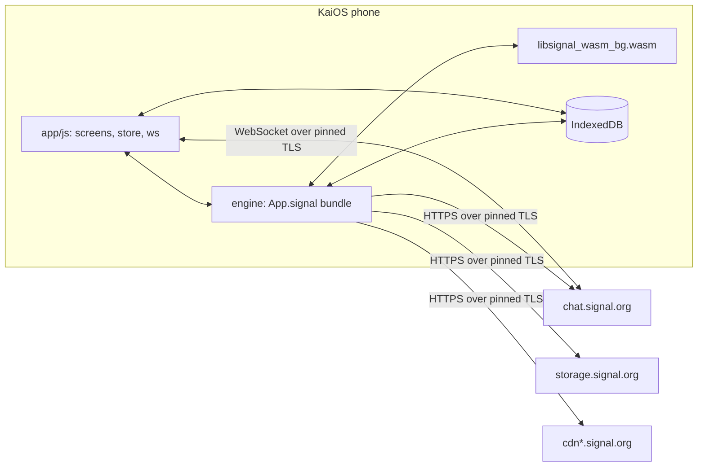
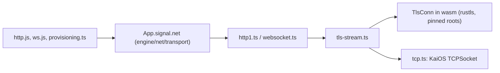
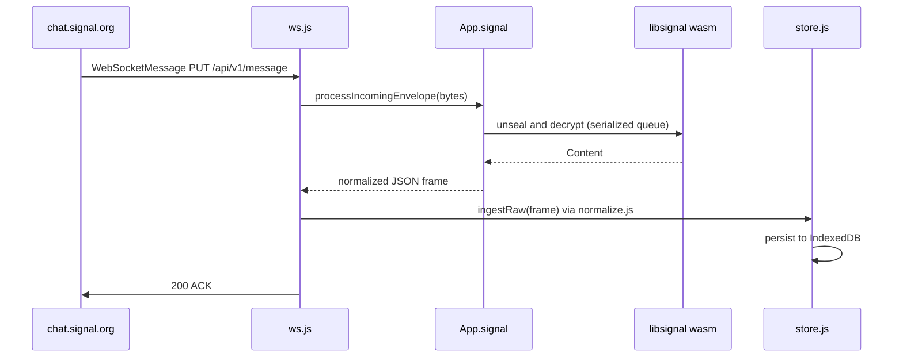
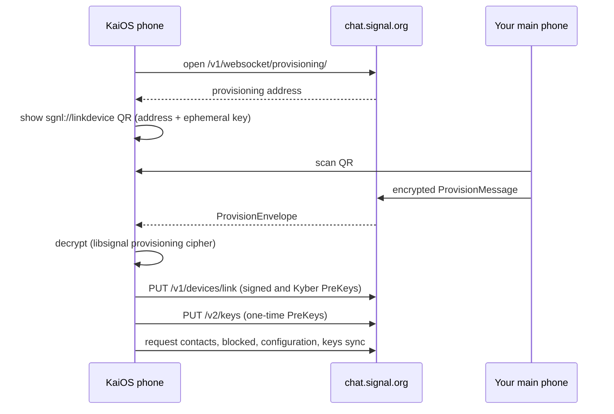
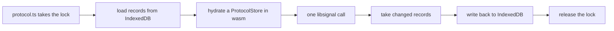

# Architecture

How signal4kaios turns a KaiOS phone into a Signal linked device. For building and testing, see [Development](development.md).

- [Overview](#overview)
- [Network](#network)
- [Repository layout](#repository-layout)
- [Receiving](#receiving)
- [Sending](#sending)
- [Storage Service writes](#storage-service-writes)
- [Group changes](#group-changes)
- [Linking](#linking)
- [The libsignal wrapper](#the-libsignal-wrapper)
- [Engine modules](#engine-modules)
- [Storage](#storage)
- [Security model](#security-model)

## Overview

The app has three layers, and the phone talks only to Signal's servers.



| Layer | Where | Role |
| --- | --- | --- |
| **UI** | [`app/js/`](../app/js) | Plain ES5-style IIFE modules on `window.App`, loaded in [`index.html`](../app/index.html) order |
| **Engine** | [`engine/`](../engine) | TypeScript bundled by esbuild into `app/vendor/signal-engine.bundle.js`, exposed as `App.signal` |
| **libsignal** | [`native/libsignal-wasm/`](../native/libsignal-wasm) | A wasm-bindgen wrapper over Signal's official [libsignal](https://github.com/signalapp/libsignal) crates, shipped as `app/vendor/libsignal_wasm_bg.wasm` |

Wire formats come from Signal-Desktop's and libsignal's own `.proto` files in [`protos/`](../protos), compiled to TypeScript with [protobuf-es](https://github.com/bufbuild/protobuf-es).

## Network

Every Signal service (`chat`, `storage`, `cdn`, `cdn2`, `cdn3`) presents a certificate from Signal's own root, `CN=Signal Messenger`, which no browser trusts. Gecko's `WebSocket` and XHR therefore fail on a stock phone with close code 1015. The app does TLS itself instead, the way Signal's own apps do:



| Piece | Role |
| --- | --- |
| [`native/libsignal-wasm/src/tls.rs`](../native/libsignal-wasm/src/tls.rs) | A sans-I/O [rustls](https://github.com/rustls/rustls) client that trusts only libsignal's pinned roots (`signal.cer`, `signal-ed25519.cer` in `res/`) and refuses any host outside `signal.org` |
| [`transport/tcp.ts`](../engine/net/transport/tcp.ts) | The raw socket, from the `tcp-socket` manifest permission (`TCPSocket`, or `navigator.mozTCPSocket` on older builds) |
| [`transport/tls-stream.ts`](../engine/net/transport/tls-stream.ts) | Pumps bytes between the socket and `TlsConn`, and resolves once the handshake is done |
| [`transport/http1.ts`](../engine/net/transport/http1.ts) | HTTP/1.1 with keep-alive, at most 6 requests per host at once, capped response sizes, and timeouts |
| [`transport/websocket.ts`](../engine/net/transport/websocket.ts) | An RFC 6455 client shaped like the browser `WebSocket`, so callers use either one |

Only `*.signal.org` goes through this path. Other hosts, and environments without `TCPSocket` (desktop browsers, the tests' fallbacks), use mozSystem XHR and the platform `WebSocket`. A redirect off Signal's hosts drops the `Authorization` header and continues over XHR.

The chat WebSocket authenticates with an `Authorization: Basic` header on the upgrade request. Signal's server treats query-string credentials as an anonymous socket that never receives messages, which is why only the pinned client can carry the main connection.

The ServiceWorker's closed-app check can't use any of this, because workers have no `TCPSocket`, and the browser `WebSocket` can't set the header. It stays as a best-effort probe; see [the user guide](user-guide.md#known-limitations).

## Repository layout

```text
app/                    the packaged KaiOS app (zipped as-is)
  js/core/              bootstrap, platform (B2G APIs), util, config, theme, toast, http, db
  js/data/              api (App.api), normalize, ws (Signal WebSocket), store, wake (closed-app alarms)
  js/ui/                nav, softkeys, router, dialogs, menus, avatars
  js/screens/           one module per screen
  sw.js                 ServiceWorker: wake alarms and notification clicks
engine/                 on-device Signal engine (App.signal)
  protocol/             libsignal loader, protocol operations, PreKeys, protocol store
  net/                  HTTP shapes, protobuf helpers, provisioning, receive, send client
  net/transport/        pinned TLS over TCPSocket: HTTP/1.1 and WebSocket clients
  services/             Storage Service, profiles, Groups V2
  crypto/               attachment and profile cipher primitives
  gen/                  generated protobuf codecs (never hand-edited)
native/libsignal-wasm/  Rust wrapper crate (AGPL-3.0-only)
protos/                 vendored Signal .proto files
scripts/                package.sh, install.sh
test/                   unit, interop, and known-answer tests
```

## Receiving



A frame is acknowledged only after it has been decrypted and stored, so a crash never loses a message. Envelopes are decrypted one at a time ([`net/client.ts`](../engine/net/client.ts) `enqueueDecryptEnvelope`). A message that fails to decrypt triggers a `DecryptionErrorMessage` retry receipt to the sender. After the initial offline queue drains (`/api/v1/queue/empty`), queued messages don't each raise a notification.

## Sending

`App.store.send*` writes an optimistic `pending` message, then calls [`App.api`](../app/js/data/api.js) → `App.signal.send`. The engine:

1. Resolves the recipient to an ACI (phone numbers via synced contacts).
2. Builds the `Content` protobuf and pads it.
3. For each of the recipient's devices, establishes a session from a PreKey bundle if needed (PQXDH) and encrypts with the Double Ratchet. When the recipient's profile key is known, it wraps the result in Sealed Sender with an `Unidentified-Access-Key`.
4. Sends `PUT /v1/messages/<aci>`, and on `409`/`410` updates the device list and retries.
5. Sends a sync copy to your other devices.

Group messages go to each member individually.

Pins (`DataMessage.pinMessage` / `unpinMessage`), disappearing-timer updates in 1:1 chats, and the full blocked list (`SyncMessage.Blocked`) use the same send path. Typing indicators and read receipts are not sent to blocked people, and content from blocked people and groups is dropped on receipt but still acknowledged.

## Storage Service writes

Contact nicknames, blocking, archive, mute, pinned chats, and the username are account state that Signal keeps in the encrypted [Storage Service](https://github.com/signalapp/Signal-Desktop/blob/main/protos/SignalStorage.proto). Edits go through `mutateStorage` in [`services/storage-service.ts`](../engine/services/storage-service.ts), following Signal-Desktop's `storage.ts`:


The new manifest keeps every identifier it doesn't touch, including record types this app doesn't read, and unknown protobuf fields survive the re-encode. Each pull marks the records another device wrote since the previous pull as `changed`. Archive, mute, and pinned-chat state is applied only from those records, and `App.store.applyChatState` applies it without writing it back, so local and remote changes don't overwrite each other in a loop.

The username itself is claimed on the chat server first: [`services/usernames.ts`](../engine/services/usernames.ts) reserves one of libsignal's candidates (`PUT /v1/accounts/username_hash/reserve`) and confirms it with a zero-knowledge proof and an encrypted username link (`PUT /v1/accounts/username_hash/confirm`). Only then are the username and link written to the account record. The QR code is `https://signal.me/#eu/` followed by the link's entropy and server ID.

## Group changes

Group edits are Groups V2 changes, built and signed as in Signal-Desktop's `groups.ts`. [`services/group-changes.ts`](../engine/services/group-changes.ts) fetches the group, builds `GroupChange.Actions` from a snapshot of the decrypted state (title, description, timer, access control, invite link, members, roles, invites, leave), and sends `PATCH /v2/groups/` at revision + 1 with a zkgroup auth credential presentation. A `409` rebuilds the change once against the new state; a `403` becomes "you don't have permission".

The server returns the signed `GroupChange`, which the bridge sends as `DataMessage.groupV2 { masterKey, revision, groupChange }` to everyone in the group before and after the change, plus a sync copy to your other devices. Adding someone joins them directly when their profile key credential can be fetched (`GET /v1/profile/{aci}/{version}/{request}?credentialType=expiringProfileKey`), and invites them otherwise.

## Linking



This follows Signal-Desktop's linking flow ([`AccountManager`](https://github.com/signalapp/Signal-Desktop/tree/main/ts/textsecure)). Afterwards the engine pulls contacts and groups from the [Storage Service](https://github.com/signalapp/Signal-Desktop/blob/main/protos/SignalStorage.proto) and group state from `storage.signal.org/v2/groups/`.

## The libsignal wrapper

The wrapper is record-in, record-out: libsignal never touches IndexedDB directly.



Every libsignal call that touches protocol state goes through [`engine/protocol/protocol.ts`](../engine/protocol/protocol.ts), which serializes these cycles. Failures come back as JS errors whose `name` is a stable code such as `UntrustedIdentity` or `DuplicatedMessage`.

| Rust module | Provides |
| --- | --- |
| `store.rs` | In-memory libsignal stores, filled with `put*` and drained with `take*` |
| `keys.rs` | Identity keys, XEdDSA, registration IDs, and PreKey, signed PreKey, and Kyber PreKey records |
| `session.rs` | PreKey bundles, encrypt and decrypt (PQXDH, SPQR), `DecryptionErrorMessage`, `PlaintextContent` |
| `sealed.rs` | Sealed Sender with SenderCertificate validation against Signal's trust roots |
| `group.rs` | Sender Key distribution and group encrypt and decrypt |
| `fingerprint.rs` | Safety numbers and scannable fingerprints |
| `provisioning.rs` | The linking cipher |
| `account.rs` | Account Entropy Pool to master key, and username hashes |
| `username.rs` | Username candidates, zero-knowledge proofs, and encrypted username links |
| `zk.rs` | Profile key version, commitment, and access key; Groups V2 params, blob and member decryption, profile key encryption, auth and expiring profile key credential presentations |
| `tls.rs` | TLS client for Signal's hosts with libsignal's pinned roots (see [Network](#network)) |

## Engine modules

| File | Responsibility |
| --- | --- |
| [`index.ts`](../engine/index.ts) | The `App.signal` bridge: recipients, sync messages, sends, blocking, group changes, pins, usernames, chat-list state, Storage Service refresh |
| [`protocol/libsignal.ts`](../engine/protocol/libsignal.ts) | Loads the wasm module (`ready()`) |
| [`protocol/protocol.ts`](../engine/protocol/protocol.ts) | Hydrate, call, and flush around each libsignal operation; trust policy; Sealed Sender trust roots |
| [`protocol/prekeys.ts`](../engine/protocol/prekeys.ts) | Signed, last-resort Kyber, and one-time PreKeys |
| [`protocol/store.ts`](../engine/protocol/store.ts) | `SignalProtocolStore` over IndexedDB (and in memory for tests) |
| [`net/http.ts`](../engine/net/http.ts) | Signal hosts and the HTTP function shapes passed in from `app/js/core/http.js` |
| [`net/proto.ts`](../engine/net/proto.ts) | WebSocket framing, service IDs, and delimited streams over the generated codecs |
| [`net/provisioning.ts`](../engine/net/provisioning.ts) | Linking, device name cipher, and the initial PreKey upload |
| [`net/receive.ts`](../engine/net/receive.ts) | Envelope decryption and `Content` → JSON frames; contact sync blobs |
| [`net/client.ts`](../engine/net/client.ts) | `SignalClient`: device fanout, Sealed Sender, retry receipts, attachment upload and download |
| [`net/transport/`](../engine/net/transport) | `App.signal.net`: pinned TLS, HTTP/1.1, and WebSocket for Signal's hosts |
| [`services/storage-service.ts`](../engine/services/storage-service.ts) | Storage Service pull and writes (`mutateStorage`, `StorageWriteQueue`), with Signal-Desktop's key derivation |
| [`services/profiles.ts`](../engine/services/profiles.ts) | Versioned profile fetch and decrypt, profile upload, avatars, username lookup, expiring profile key credentials |
| [`services/groups-v2.ts`](../engine/services/groups-v2.ts) | zkgroup group IDs, `GroupContextV2`, group state fetch and decode, invite links |
| [`services/group-changes.ts`](../engine/services/group-changes.ts) | Groups V2 change builders and `applyGroupChange` |
| [`services/usernames.ts`](../engine/services/usernames.ts) | Username reserve, confirm, delete, and link URLs |
| [`crypto/`](../engine/crypto) | WebCrypto AES and [`@noble/hashes`](https://github.com/paulmillr/noble-hashes) HMAC/HKDF for attachments, profiles, and storage |

## Storage

Each account has its own IndexedDB database (`App.db`, schema version 4):

| Store | Holds |
| --- | --- |
| `messages`, `conversations`, `contacts` | Chat history and the conversation list |
| `kv` | Synced contacts and groups, credentials caches, and settings |
| `attachments` | Cached decrypted media (LRU) |
| `signal_keystore`, `signal_identities`, `signal_sessions`, `signal_prekeys`, `signal_sender_keys` | Serialized libsignal records and remote identity keys |

Upgrading from a database older than version 4 discards the protocol state and asks you to link again. The database is named after the account's number, which isn't known until the `ProvisionMessage` arrives, so linking switches to the new account's database (`App.db.useAccount`) before it saves any keys.

## Security model

- **Keys stay on the phone.** Identity keys, sessions, and the account password live only in IndexedDB. The ServiceWorker's wake probe caches the login in origin-isolated Cache Storage so it can check Signal's queue.
- **Untrusted input.** WebSocket frames, protobufs, and HTTP responses are all parsed defensively; a bad frame is logged and dropped.
- **Sync messages** are accepted only from our own ACI. Recipients must be ACIs.
- **Identity changes.** A contact's first identity key is trusted on first use. If it later changes, the contact drops to untrusted, and if you had verified them, sending stops until you review the new safety number.
- **Sealed Sender** certificates are checked against Signal's production trust roots.
- **TLS.** Connections to Signal's hosts trust only the two roots libsignal pins, not the phone's certificate store, so a CA added to the phone can't intercept them.
- **CSP.** The privileged-app CSP forbids `eval`, `new Function`, and inline scripts, and `scripts/package.sh` fails the build if any shipped script contains them.
- **Logs.** The debug log never records keys, passwords, or provisioning codes.
