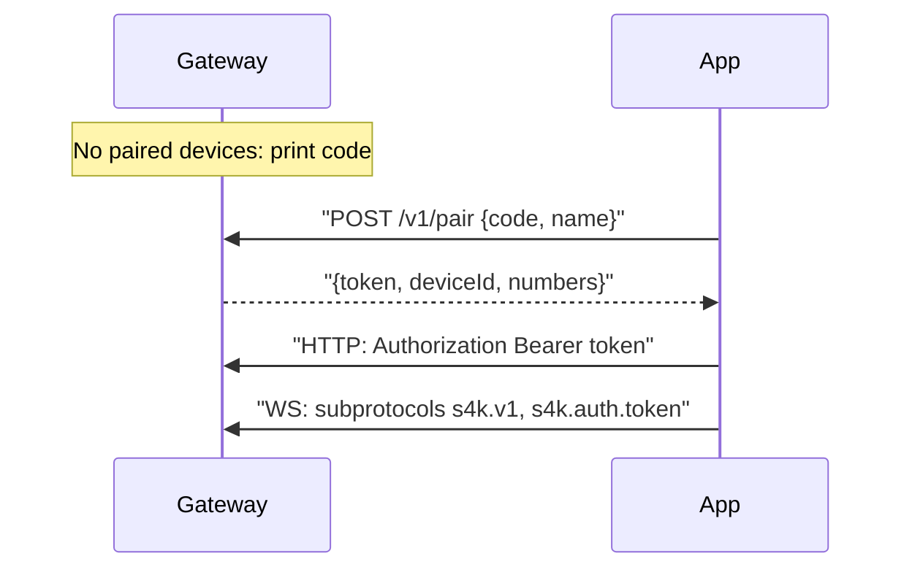

# Development

Everything for working on signal4kaios: how it's built, the gateway and its protocols, and how to test and release. [AGENTS.md](../AGENTS.md) has the condensed rules.

- [Ground rules](#ground-rules)
- [Architecture](#architecture)
- [The gateway](#the-gateway)
- [Developing and testing](#developing-and-testing)
- [Packaging and releasing](#packaging-and-releasing)
- [Code conventions](#code-conventions)

## Ground rules

- **The KaiOS app (`app/`) has no build step, bundler, package manager, or dependencies.** Files are served as-is. Don't add npm, transpilers, or a framework to it.
- **The gateway (`gateway/`) is a separate Node/TypeScript service** with its own `package.json`, `tsc` build, and tests. The app's constraints below don't apply to it.
- The app is **privileged**; its CSP forbids inline scripts, styles, and event handlers.

### Gecko 48 constraints

KaiOS 2.5 runs Gecko 48 (ES5-era), and it's the lowest common denominator, so all first-party app code stays ES5. [`app/scripts/package.sh`](../app/scripts/package.sh) fails packaging on the first four:

| Banned | Use instead |
|---|---|
| `async` / `await` | Promises with `.then()` / `.catch()` |
| Spread / rest `...` | `Object.assign`, `Function.prototype.apply`, manual copies |
| `String.padStart` / `padEnd` | Manual padding (see `util.pad2`) |
| CSS `display: grid` | Flexbox |
| ES modules (`import` / `export`) | Plain scripts on the `App` global |
| Arrow functions, template literals, `let` / `const`, classes | `var`, `function`, string concatenation |
| Inline `onclick=` / `<script>` / `<style>` | `addEventListener`, external `.js` / `.css` |

### Cross-version support

One package runs on KaiOS 2.5, 3.0, 3.1, and 4.0. It ships both [`manifest.webapp`](../app/manifest.webapp) (2.5) and [`manifest.webmanifest`](../app/manifest.webmanifest) (3.0+); the OS reads the one it understands.

| Concern | KaiOS 2.5 | KaiOS 3.0 / 3.1 / 4.0 |
|---|---|---|
| Engine | Gecko 48 (ES5) | Gecko 84 / 123 |
| Origin | `app://…` | `http://signal4kaios.localhost` |
| Web activities | `MozActivity` | `WebActivity` |
| Device storage | `navigator.getDeviceStorage` | `navigator.b2g.getDeviceStorage` |
| Alarms | `navigator.mozAlarms` | `navigator.b2g.alarmManager` + ServiceWorker |

**Never call a version-specific B2G API directly.** Go through [`platform.js`](../app/js/platform.js) (`App.platform`), which feature-detects the 3.0+ shape, falls back to 2.5, and always returns a Promise.

## Architecture

```
ws.js ──▶ normalize.js ──▶ store.js ──▶ IndexedDB (db.js)
(receive)  (frame→events)     │
                              └──▶ emits events ──▶ js/screens/* patch the DOM
```

Each file is an IIFE that attaches its API to the global `App`. Screens only consume store events; they never parse frames or write message data.

- **Receive:** [`ws.js`](../app/js/ws.js) holds the WebSocket to the gateway's `/v1/receive/<number>?since=<seq>`, with backoff, reconnect-on-foreground, a heartbeat, and a wake alarm. Each frame's `data` goes through [`normalize.js`](../app/js/normalize.js), the only parser, which turns a signal-cli envelope into typed events and logs (never throws on) unknown shapes. [`store.js`](../app/js/store.js) applies events, persists them, and emits `message`, `conversations`, `typing`, `connection`, and so on. Read-modify-write updates (reactions, receipts, edits, deletes) run through one serial queue, `enqueueMutation`.
- **Send:** screens call `App.store.send*`, which writes an optimistic `pending` record, calls [`api.js`](../app/js/api.js) → [`http.js`](../app/js/http.js), then marks it `sent` or `failed`.
- **Push:** [`push.js`](../app/js/push.js) subscribes on boot and registers with the gateway; [`sw.js`](../app/sw.js) shows notifications while the app is closed and relays alarms and notification clicks to the page.

### Modules

Load order is the `<script>` order in [`app/index.html`](../app/index.html).

| File | Responsibility |
|---|---|
| `polyfills.js` | Gecko 48 shims; creates `window.App` |
| `platform.js` | Cross-version B2G abstraction (activities, storage, alarms) |
| `util.js` | `el`, formatting helpers, `appVersion`, the `dbg` ring buffer |
| `config.js` | `localStorage` settings: gateway URL, number, device token, feature flags, saved accounts |
| `http.js` | `mozSystem` XHR with `Authorization: Bearer <device token>`; fires `App.http.onUnpaired` on a 401 |
| `api.js` | REST wrappers, plus the gateway's `health`, `pair`, `unpair` |
| `db.js` | IndexedDB: the message history |
| `normalize.js` | Envelope → typed events |
| `ws.js` | Receive socket (backlog cursor, reconnect, subprotocol auth, close 4401 = unpaired) |
| `store.js` | State hub: apply, persist, emit; optimistic sends; serialized mutations |
| `push.js` | Web Push subscribe and register; caches gateway details for `sw.js` |
| `nav.js`, `softkeys.js`, `router.js` | D-pad selection, softkey labels, screen stack + key dispatch |
| `main.js` | Boot: first screen (welcome, pairing, or conversations), store init, push |
| `screens/*.js` | One file per screen |

Vendored libraries (`qrcode.js`, `jsQR.js`) live in [`app/vendor/`](../app/vendor), outside the packaging gate.

### Storage

Config lives in `localStorage` (`s4k.config`). Message history lives only in IndexedDB, one database per account (`signal4kaios:<number>`), because signal-cli has no history endpoint. It's pruned to about 500 messages per conversation.

| Store | Key | Notes |
|---|---|---|
| `messages` | `convId\|timestamp\|author` | Index `conv` on `[convId, timestamp]`; optional `pinned`, `expiresAt` |
| `conversations` | peer number/uuid, or `g:` + group id | Local `pinned`, `archived`, `muted`, last `expireTimer` |
| `contacts` | uuid, else number | Directory |
| `attachments` | `id` | LRU blob cache |
| `kv` | `k` | Small values, e.g. `wsCursor` (backlog resume point) |

### Normalized events

```
message      { convId, groupInternalId?, incoming, author, authorName,
               timestamp, body, styles, quote?, attachments, expiresInSeconds? }
edit         { convId, author, targetTimestamp, newBody, newStyles, timestamp }
reaction     { convId, reactor, emoji, remove, targetAuthor, targetTimestamp }
remoteDelete { convId, author, targetTimestamp }
pin / unpin  { convId, targetAuthor, targetTimestamp }
typing       { convId, author, started }
receipt      { peer, kind: 'delivery' | 'read', timestamps: [..] }
readSync     { entries: [{ sender, timestamp }] }
```

Messages sent from your other devices arrive as `syncMessage`s and become the same `message` / `edit` events with `incoming: false`. Delivery status only moves forward (`pending/failed < sent < delivered < read`).

### Screens

Screens come from a `create()` factory and are driven by [`router.js`](../app/js/router.js), which keeps a stack (paused screens keep their DOM) and one global `keydown` listener. Unhandled `Backspace` pops the stack; KaiOS's Back key sends Backspace. The contract:

```js
{
  el,                      // root element (class 'screen')
  enter: function () {},   // first shown: subscribe, set softkeys, render
  resume: function () {},  // shown again after a child pops
  pause: function () {},   // a child screen is covering this one
  destroy: function () {}, // popped: unsubscribe, revoke object URLs
  onKey: function (evt) { return handled; }
}
```

To add one: create `app/js/screens/<name>.js` registering `App.screens.<name>`, mark focusable nodes `nav-selectable` and drive them with an `App.Nav`, set softkeys with `App.softkeys.set(left, center, right)`, and add its `<script>` tag to `index.html` before `main.js`. [`screens/menu.js`](../app/js/screens/menu.js) is the smallest example.

## The gateway

The app talks only to the gateway ([`gateway/`](../gateway)), which sits in front of signal-cli-rest-api (in `json-rpc` mode, on an internal network). It:

- **reverse-proxies** HTTP to signal-cli (stripping the app's `Authorization` header);
- holds signal-cli's receive socket open around the clock and **buffers** frames (500 per number by default), so a reconnecting app replays what it missed. Without it, signal-cli drops messages that arrive while no client is connected, and KaiOS can't keep a WebSocket alive in the background;
- sends **Web Push** so a closed app still gets notified;
- **authenticates every request** with a paired device token.

### Pairing and auth



- **Codes** ([`auth.ts`](../gateway/src/auth.ts)) are 8 digits, single-use, and valid for 15 minutes; issuing one replaces any outstanding code. A wrong guess counts against every outstanding code, and 5 misses burn it. `/v1/pair` is also limited to 10 attempts per IP per 15 minutes. The gateway prints a code at startup when no device is paired; `npm run pair` issues one any time.
- **Device tokens** are 32 random bytes (hex). Only SHA-256 hashes of codes and tokens are stored (`devices`, `pairing_codes` tables). Tokens don't expire; `npm run revoke <id>` or `POST /v1/pair/revoke` removes the device and its push subscriptions, and its open sockets close within a minute.
- **WebSocket auth:** browsers can't set headers on a WebSocket, so the app offers subprotocols `['s4k.v1', 's4k.auth.<token>']`. The gateway answers `s4k.v1` (never echoing the token). A bad token gets the upgrade accepted and then closed with **4401**, which the app treats as "unpaired" rather than "offline".
- The operator CLI ([`cli.ts`](../gateway/src/cli.ts)) shares the SQLite file (WAL mode) with the running server.
- **Account linking:** `npm run link [name]` calls signal-cli's `GET /v1/qrcodelink/raw` over the internal network ([`signal.ts`](../gateway/src/signal.ts)), draws the `sgnl://linkdevice` URI as a terminal QR code, and polls `/v1/accounts` until a new number appears (3-minute limit). signal-cli's port is never published. `/v1/accounts` is parsed in both its `["+1…"]` (≤ 0.101) and `[{ number, aci }]` shapes; numberless accounts are skipped.

### HTTP surface

| Route | Auth | Notes |
|---|---|---|
| `GET /healthz` | none | `{ ok, gateway: 'signal4kaios' }`; the app's reachability probe |
| `POST /v1/pair` | none | `{ code, name }` → `{ token, deviceId, numbers }`; 403 bad code, 429 throttled |
| `POST /v1/pair/revoke` | token | Unpair the calling device |
| `GET /v1/push/vapid` | token | `{ publicKey }` (empty only if VAPID setup failed) |
| `POST /v1/push/register` | token | `{ number, subscription }`, tied to the device |
| `POST /v1/push/unregister` | token | `{ endpoint }` |
| `POST /v1/push/test` | token | `{ number, empty? }`: push a test note, return per-subscription status |
| `OPTIONS *` | none | CORS preflight (the ServiceWorker's fetches are cross-origin) |
| everything else | token | Proxied to signal-cli; 401 `{ error: 'unpaired' }` without a valid token |

### Receive protocol

`GET /v1/receive/<number>?since=<seq>[&ep=<push endpoint>]` (WebSocket). The gateway replays buffered frames with `seq > since` as `backlog` envelopes, sends `backlog-done` with the newest `seq`, then streams live `frame`s:

```json
{ "t": "backlog" | "backlog-done" | "frame", "seq": 42, "data": { "...": "raw signal-cli frame" } }
```

The app ingests `backlog` silently (no notification), persists the cursor from each `seq`, and resumes with `?since=` next time. `ep` lets the gateway skip push only for devices that are currently open.

### Push

On boot the app fetches the VAPID key, subscribes, and registers; it caches the gateway URL, number, VAPID key, and device token in Cache Storage so `sw.js` can re-register a rotated subscription while closed. On 3.0+ it also calls `systemMessageManager.subscribe` for `notification` and `alarm`.

KaiOS's push service (`notification.kaiostech.com`) only accepts **`aesgcm`** encoding and only delivers a **payload** when VAPID-signed. With VAPID the gateway sends the note as an encrypted payload; without it, an empty push shows a generic "New message". VAPID keys come from `VAPID_PUBLIC` / `VAPID_PRIVATE` if both are set; otherwise the gateway generates a pair on first start and stores it in the `settings` table, so it survives restarts and image updates. A changed key makes the app re-subscribe on its next launch. With `PUSH_WHEN_IDLE_ONLY=true` (default), devices with the app open are skipped. Debug with the gateway log (`push: sent … (201)`) or `POST /v1/push/test`.

### Configuration

| Variable | Default | Purpose |
|---|---|---|
| `PORT` | `8090` | Listen port |
| `SIGNAL_CLI_URL` | `http://127.0.0.1:8080` | signal-cli-rest-api base URL |
| `DB_PATH` | `./data/gateway.db` | SQLite: buffer, subscriptions, devices, codes, generated VAPID keys |
| `RETENTION_PER_NUMBER` | `500` | Frames buffered per number |
| `PUSH_WHEN_IDLE_ONLY` | `true` | Skip push for devices with the app open |
| `VAPID_PUBLIC` / `VAPID_PRIVATE` / `VAPID_SUBJECT` | generated / generated / `mailto:admin@example.com` | Optional VAPID keys (`npx web-push generate-vapid-keys`); generated and stored when unset |

### Security notes

- The gateway sees all message content; trust it like signal-cli itself.
- Use HTTPS outside a trusted LAN; on plain HTTP the code and token are visible to anyone watching the network.
- Notification text leaves your network via the KaiOS push service.
- Never log codes or tokens. The startup/CLI pairing banner is the only place a code is printed; numbers and push endpoints are masked in logs.

## Developing and testing

**Gateway** (Node 26 or newer):

```sh
cd gateway
npm install
npm run build      # type-check + compile to dist/
npm test           # unit tests (node:test)
SIGNAL_CLI_URL=http://127.0.0.1:8080 npm start
npm run link       # in another shell: link a Signal account (same SIGNAL_CLI_URL)
npm run pair       # issue a pairing code
```

To run your local gateway changes in Docker instead of the published image, add the build override from the repo root: `docker compose -f docker/docker-compose.yml -f docker/docker-compose.build.yml up -d --build`. It tags the result `signal4kaios-gateway:local`, so `docker compose pull` won't replace it.

**App on the desktop:** `http.js` falls back to a plain XHR when `mozSystem` isn't available, so you can iterate in a browser behind a CORS proxy:

```sh
cd app && python3 -m http.server 8000
npx local-cors-proxy --proxyUrl http://192.168.1.100:8090 --port 8091
```

Pair with the proxy address (`http://localhost:8091`). The desktop doesn't enforce the privileged CSP, so verify on a device or the simulator too.

**On KaiOS:** prefer the 2.5 simulator (kaiosrt via WebIDE) or a 2.5 device for a Gecko 48 check; install on 3.0+ with [`install-kaios3plus.sh`](../app/scripts/install-kaios3plus.sh) and debug in Firefox at `about:debugging`. Re-install after any manifest permission change. **Settings → Debug log** is the main diagnostic on the phone.

## Packaging and releasing

```sh
sh app/scripts/package.sh
```

Runs the Gecko 48 gate on `app/js` and `app/css`, checks that both manifests have the same version, and writes `dist/signal4kaios.zip` plus `dist/signal4kaios-<version>.zip` (`app/scripts/` is excluded).

**Releasing** is tag-driven ([`release.yml`](../.github/workflows/release.yml)):

1. Bump `version` in **both** manifests. Never change the app `id` / `origin` (`signal4kaios`).
2. Add a `## v1.2.0` section to [`CHANGELOG.md`](../CHANGELOG.md) describing the release for users. It becomes the release notes, and the release fails without it.
3. Commit, then `git tag v1.2.0 && git push origin v1.2.0` (pre-releases: `v1.2.0-rc1`).
4. CI packages with `RELEASE_TAG` set and publishes a GitHub Release titled with the tag, carrying the changelog section, install instructions, and the ZIP. The same tag also publishes the gateway image (below).

**Gateway image.** [`gateway-image.yml`](../.github/workflows/gateway-image.yml) builds [`docker/Dockerfile`](../docker/Dockerfile) for `linux/amd64` and `linux/arm64` and pushes it to `ghcr.io/ambercaravalho/signal4kaios-gateway`, which [`docker/docker-compose.yml`](../docker/docker-compose.yml) pulls as `:latest`:

| Trigger | Tags |
|---|---|
| Release tag `v1.2.0` | `1.2.0`, `1.2`, `latest`, `sha-<commit>` |
| Pre-release tag `v1.2.0-rc1` | `1.2.0-rc1`, `sha-<commit>` (never `latest`) |
| Push to `main` touching `gateway/` or `docker/` | `edge`, `sha-<commit>` |
| Pull request touching `gateway/` or `docker/` | Built for amd64 only, not pushed |

The first push creates the package as private. Once, in the repo's **Packages → signal4kaios-gateway → Package settings**, set its visibility to **Public** so `docker compose pull` works without logging in.

**Dependency updates.** [Dependabot](../.github/dependabot.yml) opens weekly PRs for the gateway's npm packages (minor and patch grouped into one PR, majors separately), the Dockerfile's Node base image, and the workflows' actions (grouped). CI and the image build run on each one. Node majors (the base image and `@types/node`) are ignored so the gateway doesn't land on a non-LTS release; move to the next LTS by hand, updating the Dockerfile, `engines` in [`gateway/package.json`](../gateway/package.json), `@types/node`, and `node-version` in [`ci.yml`](../.github/workflows/ci.yml) together.

## Code conventions

- One IIFE per file (`(function () { 'use strict'; … })();`), public surface on `App`; reach other modules only through `App.*`.
- Build DOM with `App.util.el(tag, className, text)`; no `innerHTML` with remote content.
- `App.util.dbg(msg, data)` for diagnostics, `App.toast(msg)` for user notices. Never log the device token or pairing codes.
- All envelope parsing in `normalize.js`; message read-modify-write through `enqueueMutation`.
- Boolean flags in `config.js` follow the `sendReadReceipts` pattern (accessor with a default).
